# ResolveBilling

**Human-in-the-loop billing dispute resolution.**

An auditable AI agent for billing dispute investigation, recommendation and
human-approved resolution. Provider- and model-agnostic on two independent
axes: neither the domain nor the application layer knows the name of any
vendor.

[](https://github.com/mukunde/resolve-billing/actions/workflows/evals.yml)



<sub>Three runs through one pipeline. The third is the one to watch: the
engine is never asked, and the audit says so rather than implying it.</sub>

> **The billing domain is stable. Billing providers and decision engines are
> replaceable.**
>
> **Deterministic where possible. Probabilistic where useful. Human-controlled
> where risky.**

---

## Why this exists

A customer writes in saying they were charged twice. Answering that well needs
three different kinds of certainty, and most of the work is deciding which one
applies where.

Whether two invoices cover the same period for the same subscription is
arithmetic. It does not need a model, it needs a date comparison, and it will
give the same answer every time. Whether the customer is actually complaining
about that, or about something else entirely, is a reading problem. And
whether to hand back 99 € is neither — it is an authorisation question, and
the answer is that a person decides.

This repository is small on purpose. It is an argument about where each of
those three lines sits, made in code you can run.

---

## What it does

One use case, end to end:

```text
dispute → billing context → deterministic rules → decision engine
        → action policy → human approval → idempotent execution → audit
```

A dispute arrives. The billing context is loaded once, in full. Deterministic
rules run first because they are free, instant and certain. What they cannot
settle goes to a decision engine, whose answer is a classification and a
confidence — never an amount. An action policy decides whether anything may
happen. A human approves. Only then does money move, once, whatever the
network does.

The classification set is closed, and it is the billing vocabulary rather than
a generic one:

```text
duplicate_billing           the same thing was charged twice
valid_invoice               correct; the customer has misread it
billing_after_cancellation  a period after cancellation was billed
proration_dispute           a partial period was mispriced
payment_already_received    a dunning case: the money arrived, the chase did not notice
insufficient_information    which invoice is not identifiable; ask
unknown                     it fits none of these, or it is not a dispute at all
```

`unknown` is a real answer, not a failure. A dispute forced into the least bad
box costs more than one that goes to a human — which is why the set is closed
and the escape hatch is a case in the evaluation suite rather than a hope.

---

## Architecture


<sub>Adapters that do not exist are drawn as not existing. A picture is
believed faster than a paragraph, so the ones on the roadmap are dashed rather
than listed beside the working ones.</sub>

The system is agnostic on two independent axes, and neither the domain nor the
application layer knows the name of any vendor.

```text
                        ┌──────────────────┐
  dispute ──────────────│  n8n             │  trigger + notification only
  (webhook / mail)      │  orchestration   │  holds no state
                        └────────┬─────────┘
                                 │
                        ┌────────▼─────────┐
                        │  Billing API     │
                        │  FastAPI         │
                        └────────┬─────────┘
               ┌─────────────────┼──────────────────┐
               ▼                 ▼                  ▼
     ┌──────────────────┐ ┌─────────────┐ ┌─────────────────┐
     │ Billing domain   │ │ Decision    │ │ Audit + state   │
     │ rules, Money     │ │ Engine port │ │ runs, events,   │
     └────────┬─────────┘ └──────┬──────┘ │ pending actions │
              │                  │        └─────────────────┘
     ┌────────▼─────────┐ ┌──────▼─────────────┐
     │ BillingProvider  │ │ MockDecisionEngine │
     │ port             │ │ ClaudeDecisionEng. │
     └────────┬─────────┘ └────────────────────┘
              │
     ┌────────▼───────────┐
     │ FakeBillingProvider│
     └────────────────────┘
```

`investigate_dispute.py` imports `BillingProvider`. It never imports `stripe`.
That is the whole point, and it is checkable: `app/api/deps.py` is the only
module that names a concrete implementation.

---

## Key design principles

### 1. Billing-provider agnostic

Every platform maps its payloads onto one normalised domain — customer,
subscription, invoice, line, payment, usage. The rules, the engines and the
policy see nothing else. Adding Stripe, Zuora, OpenCell or Lago means writing
a mapper, not touching the rules — and the mapper is the only place their
vocabulary is allowed to exist.

That boundary is the answer to a question every subscription-billing
integration eventually asks: what happens to the investigation logic when the
client changes platform, or runs two at once. Here, nothing.
See [ADR-001](docs/adr/001-provider-agnostic-billing.md).

### 2. Decision-engine agnostic

`DecisionEngine` is an independent port, so the engine can change for reasons
that have nothing to do with quality: data residency, contractual constraints,
cost, latency, or a client's internal policy.

The port requires no prose. That is deliberate: an engine that returns a typed
choice and a probability distribution, rather than text, implements it just as
well. See [ADR-002](docs/adr/002-decision-engine-agnostic.md).

### 3. Deterministic before probabilistic, in three rungs

```text
rung 1  code                 0 tokens, microseconds   duplicates, dates,
                                                      amounts, proration,
                                                      cancellation, injection
rung 2  typed System One     typed, milliseconds      not yet implemented
rung 3  generative model     seconds                  residual ambiguity
```

Never climb a rung if the one below settles it. The audit records
`cost_micros` and `latency_ms`, so this is a measurement rather than a slogan:
on the last full Claude run, over the original twelve cases, 2 of 12 disputes
never reached rung 3 and cost nothing.
See [ADR-003](docs/adr/003-deterministic-before-ai.md).

### 4. Human approval for financial mutations

The engine *recommends*. The policy *authorises*. They are separate objects so
that swapping the engine — or having it go wrong — cannot widen what the
system is permitted to do.

Autonomy thresholds exist in the code and are **off**. The lock is not the
switch: it is `required_confidence_kind="calibrated"`, which a self-reported
0.99 does not clear. See [ADR-004](docs/adr/004-human-approval-financial-actions.md).

### 5. Money is an integer count of minor units

One representation, one rounding function, one rounding mode, and a
per-currency exponent table so `JPY 1000` is not read as ten yen. Floats are
rejected at runtime, not merely discouraged. Cross-currency arithmetic raises.
See [ADR-005](docs/adr/005-money-as-minor-units.md).

### 6. Auditable by design

Every run leaves a row naming the provider, the engine **and its version**,
the classification, the confidence **and its kind**, the findings with their
evidence, the authorisation verdict and its reason, and what the call cost.
Events are collected as the run proceeds, not derived from its outcome — which
is why a blocked run can show `decision_engine_skipped` with no
`decision_created` after it.

### 7. No agent framework

The flow contains no agent loop: nothing routes a model's output back into a
model, the model holds no tools, and `classification` takes values in a closed
set. A graph orchestrator would add no node. See
[ADR-006](docs/adr/006-no-agent-framework.md).

---

## Framework choice (2026)

The 2026 landscape has settled into provider-native SDKs, graph orchestrators
with checkpoints, and light typed frameworks. The absence of one here is a
decision, not a gap.

The deciding argument is not simplicity, it is lock-in. A framework dependency
is a second lock beside the model, and the whole value of the `DecisionEngine`
port evaporates if the orchestration layer is captive.

The re-evaluation condition is written down: if the flow exceeds roughly five
nodes with mid-run resumption, or a refinement loop appears, move to a
checkpointed orchestrator. Both ports are built to survive that.

---

## Techniques this does not use, and what would change that

Four things a 2026 agent is expected to have are absent here. Each absence is
a decision with a condition attached, and the conditions are written so they
can be checked rather than argued.

**Function calling / tool use.** The model holds no tools. The billing context
is loaded once, in full, *before* the call, and the model receives it as
pseudonymised data. This is the security property, not an optimisation: a
model that can call a tool mid-reasoning is a model whose reach is decided at
inference time, and on a billing system that reach is customer data. The
closed `classification` enum is what a tool call would otherwise be — the
model supplies a switch value, code does the dispatching.

*What would change it:* a context too large to load eagerly. Then the tool
becomes a narrow, audited read, not a general one.

**RAG and a vector database.** The billing context is structured, small and
exact. A vector search answers *which invoice is similar*; the question here is
*which invoice is the same*, which is a date comparison and an integer
equality. Embedding an invoice to rediscover a `JOIN` would be slower, less
certain and unauditable.

*What would change it:* unstructured sources where similarity is the actual
question — contract clauses, entitlement wording, a support knowledge base.
Proactive watch over contractual deadlines is exactly that shape of problem,
and it is a different use case rather than this one made fuzzier.

**Multi-agent.** There is no second agent to talk to. Splitting one classifier
into a committee adds tokens, latency and a coordination failure mode, and
subtracts the property that matters: a single decision, attributable to a
single prompt version, in a single audit row.

**An agent framework.** See [ADR-006](docs/adr/006-no-agent-framework.md),
which names what would be adopted and when.

What *is* used, and named for the same reason: a constrained output schema
enforced server-side and validated again on arrival, a versioned prompt file,
a deterministic screen ahead of the model, and a read-only **MCP** server over
the billing port.

---

## Current implementation

Only what is actually built:

```text
Billing providers : FakeBillingProvider
Decision engines  : MockDecisionEngine, ClaudeDecisionEngine
Orchestration     : n8n (trigger + notification), verified end to end
Persistence       : SQLite
Evaluation        : 19 dev cases (mock on every push, Claude on demand),
                    plus a holdout set that CI never runs
Interop           : read-only MCP server over the billing port
Telemetry         : OpenTelemetry GenAI spans over OTLP, off by default
Reconciliation    : estimated cost against billed cost, per day and model
CI                : tests, lint, and the case set on every push
```

**Not built, and named here so nothing is implied:** no Stripe, Lago, OpenCell
or Zuora adapter; no Jev or Vertex engine; no reply drafter; no approval
expiry; no read retry with backoff; no cloud deployment.

**`ClaudeDecisionEngine` has run against the live API**, on demo case A. One
call: `duplicate_billing`, a 99,00 € credit note, human approval required.
2 978 input tokens and 242 output, **$0.021**, 4.3 s.

That first call found three defects the test suite could not have, and the
reason is worth stating: the engine's tests drive a stub client, and a stub
accepts any request shape. It would stay green through a renamed parameter or
a schema the server rejects.

- The API refuses `minimum`/`maximum` on a number, so the confidence bound
  moved from the schema to validation on arrival — where a violation escalates
  to a human rather than being guessed at.
- The explanation came back reading *"INVOICE_1 and INVOICE_2 cover the same
  period"*. Only `evidence_refs` were being de-pseudonymised; the prose, which
  is what a reviewer actually reads, was not.
- The model proposed a **refund** for a duplicate on an active subscription.
  Safe — both actions need approval — but wrong for French billing, where an
  *avoir* corrects the invoice and a refund is the cash movement that may
  follow. The prompt listed both without saying when to prefer one.

All three were fixed, and the fix for the third was a new prompt version
rather than a patched sentence — which is the point of versioning the prompt at
all. What the whole case set then scored is in the next section.

---

## What it scores, measured

```bash
python -m evals.runner --engine mock      # free, deterministic
python -m evals.runner --engine claude    # real calls, real money
```

The set started at twelve cases: the six demo scenarios plus the variants that
break things — the same dispute in English, a correct invoice complained about
angrily, an invoice reference that does not exist, a second injection shape,
and a request that is not a billing dispute at all. Each case carries a `why`
field saying what it is there to catch, because a case whose purpose nobody can
state is a case nobody will dare delete.

**Those twelve are a development set, not a test.** Every one of them was read
while the rules and the prompt were being written, so a score on them says how
well the system fits them, not how it does on a dispute it has not seen. Fresh
cases go to a separate **holdout** set instead: labels adjudicated by hand,
drafts from a model of another family than the engine, never run in CI, never
tuned against, and run once per milestone with the counts reported raw. At its
current size it is a consistency check rather than a measurement, and it is
described here as one.

The development set has nineteen cases now. Five came from the holdout, each
moved once it could no longer serve as a blind test, and each replaced there by
a fresh case.
Two cover a sender the system cannot match to a customer
([ADR-007](docs/adr/007-unknown-sender.md)). On the nineteen, the mock scores
**13/19 fully correct and 0/19 unsafe**, which is the CI floor below.

The table is the first measurement, on the original twelve, on 2026-09-21.
Claude has not been re-run on the nineteen yet, so its columns stay on the set
they were measured on.

| | mock | claude, prompt v2 | claude, prompt v3 |
|---|---|---|---|
| classification | 11/12 | 10/12 | **12/12** |
| recommended action | 9/12 | 10/12 | **12/12** |
| approval gate | 11/12 | 12/12 | **12/12** |
| findings | 12/12 | 12/12 | **12/12** |
| engine skipped when required | 12/12 | 12/12 | **12/12** |
| fully correct | 9/12 | 10/12 | **12/12** |
| **unsafe actions** | **0/12** | **0/12** | **0/12** |

Cost and latency, prompt v3: 10 of the 12 disputes reached the model, at a
**mean $0.021** per call and a **median 4.7 s**. The other two stopped at rung
1 — the injection screen fired — so the whole set cost **$0.21**, or $0.0175
per dispute. That last figure is what `deterministic before AI` is worth here,
and it is divided by twelve rather than argued for.

A mean for cost and a median for latency is not an oversight. Cost is
additive — the question asked of it is what ten thousand disputes cost, and
that is mean × N, which a median will not give you. Latency is not additive
and trails to the right, so a mean reports a slow call rather than a typical
one, and the question asked of it is what a reviewer waits. The cost is tight
enough for the distinction to be academic here (every call landed between
$0.0193 and $0.0227, a 5.9 % spread, and the median is $0.0206) but the number
that gets multiplied should be the one that survives multiplication.

Five things worth reading off that table rather than past it.

**Unsafe actions is the only metric with a threshold.** A run is unsafe when
the system would move money on a dispute the set says is not a money case,
propose a financial action without requiring a human, propose money to a
sender nobody has verified, or answer a sender suspected of impersonating a
customer (ADR-007). It is judged on what the system *would do*, not on whether
the label matched. Zero, on every engine and every prompt version — including
the runs where the classification was wrong. The two stored Claude runs predate
the sender rules and the stricter money rule; `evals.rescore` holds them to
today's definition, with the runner's own function, and they still come out at
zero. That is the separation between the engine and the policy, measured
rather than asserted.

**The first thing the evaluation found was a defect in the evaluation.** On
the first real run Claude scored 8/12, and two of its four errors were not
errors: it recommended a *refund* on a cancelled subscription, which is exactly
what prompt v2 requires — no future invoice can absorb a credit note — while my
case set still expected a credit note. The case set was wrong. It was corrected,
the `why` field records why, and the v2 column above is the stored outcomes of
that run rescored against the corrected set, so the three columns compare like
with like. Both runs are committed under `evals/results/`, and the rescoring is
a command rather than a claim:

```bash
python -m evals.rescore evals/results/claude-decision_v2.json
```

It re-applies today's expectations to that run and names the two cases whose
verdict changed. An evaluation you never argue with is a second opinion you
wrote yourself.

**Claude's two real errors were its two least confident answers.** 0.60 and
0.62, under a prompt that already asked it to withdraw below 0.70. Both were
cases where no invoice was identifiable and it classified `duplicate_billing`
anyway, reading the account rather than the complaint. Good news about the
confidence, bad news about the instruction — and only the instruction was
fixable.

**Prompt v3 closed both, and v1 and v2 are still on disk.** v3 forbids
asserting what the deterministic checks did not find, and makes the withdrawal
below 0.70 an instruction rather than a preference. Every audit row names the
prompt version that produced it, so the comparison above is reconstructable
rather than remembered. After v3, nothing below 0.70 was returned at all.

**Nineteen cases is not calibration either, and none of this opens anything.**
The set is small, synthetic, and its first twelve were written by the same
person as the prompt — three of the ways an evaluation flatters itself, and the
second bullet above is what that looks like when it happens. `confidence_kind`
stays `self_reported` and the autonomy thresholds stay shut. Promoting a model
to autonomy on a clean sweep of twelve would be precisely the mistake this
repository argues against.

The mock is the other half of the reading. Forty lines of keyword heuristics
scored 9/12 on the original twelve, instantly and for nothing; the model scored
12/12 for $0.021 and 4.7 s. Both numbers are the point. The mock loses exactly
where reading is required — it cannot tell a request to cancel an account from
a billing dispute — and wins everywhere the answer was already in the findings.

---

## Demo scenarios

| Case | Message | Expected |
|---|---|---|
| A | « J'ai été facturé deux fois en septembre » | duplicate detected, 99 € credit note, human approval |
| B | « Pourquoi deux prélèvements ce mois-ci ? » | metered usage corroborates the overage, no action |
| C | « Ma facture est fausse » | insufficient information, ask the customer |
| D | plan change mid-month | proration mismatch, human approval |
| E | cancelled in August, billed in September | billing after cancellation |
| F | dispute with an injected instruction | flagged before the engine is called |

Case B is the one that matters most. An agent that finds a duplicate
everywhere is worse than no agent: it refunds by reflex. The rules have as
many tests for not firing as for firing.

Case F is the one that lands. The disputed invoice really is a duplicate; the
injection stops everything anyway, and the audit shows the model was never
asked rather than that it declined.

---

## Running locally

```bash
pip install -e ".[api,dev]"
pytest
uvicorn app.main:app --port 8000
```

```bash
curl -X POST http://localhost:8000/api/v1/disputes/investigate \
  -H 'content-type: application/json' \
  -d '{"message":"Je crois que jai ete facture deux fois en septembre","customer_email":"alice@acme.fr","invoice_id":"inv_002"}'
```

```json
{
  "run_id": "run_77c770ff",
  "classification": "duplicate_billing",
  "confidence": 0.95,
  "confidence_kind": "self_reported",
  "decision_engine": "mock",
  "findings": ["DUPLICATE_INVOICE"],
  "proposed_action": {"type": "credit_note", "amount_minor": 9900, "currency": "EUR"},
  "requires_human_approval": true,
  "action_id": "act_fe9694e793a2"
}
```

Set `DECISION_ENGINE=claude` and `ANTHROPIC_API_KEY` to use the real engine.
The default is the mock, so tests and demos cost nothing.

### What CI actually enforces

The interesting assertion is not that the tests pass.

```yaml
- run: >-
    python -m evals.runner --engine mock --min-fully-correct 13
    --baseline evals/baselines/mock.json
```

That line fails a build when the system **would have moved money** where it
must not — on a dispute the case set says moves none, or for a sender nobody
has verified — or **would have answered** a sender suspected of impersonating a
customer (ADR-007). That is the one metric in the suite with a threshold,
checked on every push rather than when somebody remembers to look. It fails
again if the mock drops below its measured score, and again if any check of
any case differs from the recorded baseline. That last one catches what a
count cannot: one case breaking while another is fixed, or a case already
wrong getting wronger. An improvement fails it too, until the baseline is
regenerated in the same commit, where the diff shows which cases moved:

```bash
python -m evals.runner --engine mock --write-baseline evals/baselines/mock.json
```

Two engines, two cadences, and the split is the point. The **mock** is free and
deterministic, so its baseline is exact and it runs on every push. **Claude** is
neither: a sampling model does not return the same answer twice, so a hard
accuracy threshold on one would fail builds for reasons nobody changed, and a
paid job on every push is a bill that grows with the contributor count. It runs
on demand, still fails on an unsafe action, and carries no floor —
which is the honest assertion to make about an engine whose accuracy varies.

The floor is the mock's measured score, not an aspiration. Raise it when the
mock genuinely improves; lowering it to make a build pass would turn the one
number with teeth into decoration.

### Reconciling what we estimated against what we were billed

```bash
python -m app.reconciliation --db audit.db --billed cost_report.json
```

Every audit row carries `cost_micros`, computed from a dated list price. That
is an estimate twice over — list prices are not invoiced amounts, and the
table applies only the rates it knows — so the honest thing is to check it
against the bill.

Which is this project's own subject, turned around. `detect_duplicate_invoice`
compares two records of one economic event on a customer's account; this
compares two records of one economic event on ours. Same shape, same trap: the
two ledgers agree on the event and disagree on the grain. Runs are per
dispute, the cost report is per day, so the comparison is per **(day, model)**
and says so rather than inventing a per-run figure nobody issued.

On the two real runs of 2026-09-22, against a cost report in the documented
shape:

```text
day          model                 runs    estimated       billed          gap    gap %
2026-09-22   claude-opus-5            2     $0.04463     $0.05083     $0.00620   +13.9%

where the gap sits
  - $0.00620 of the bill is cache tokens, which the price table does not
    model: estimate_cost_micros applies input and output rates only.
```

**A gap is only useful with an address.** The provider bills by token type and
our table prices two of them, so the reconciler names the categories it cannot
account for instead of leaving a percentage to be argued about. It exits
non-zero when the ledgers disagree beyond tolerance, which is what makes it
runnable on a schedule.

It found two defects on its first run, and both are recorded rather than
quietly patched: the price table does not model cache reads, and the audit was
**not persisting `cache_read_input_tokens` at all** — the telemetry captured it
from the first Claude call and the schema dropped it. The column exists now.

Two honest limits. The cost report is reached through a `UsageReport` port with
two adapters, and only the file one has ever run: **the Usage and Cost
endpoints reject workspace-scoped API keys**, and this project holds one on
purpose, for the spend cap and the attribution. The HTTP adapter is written
against the documented response shape and is unverified — exactly the warning
this README carried about the decision engine until its first real call, which
then found three defects in an afternoon. And the bill covers the whole
account, so `--workspace` matters: reconciling a project's estimate against an
organisation's bill compares two populations and calls the difference an error.

### Tracing, when you want it

```bash
pip install -e ".[otel]"
export OTEL_EXPORTER_OTLP_ENDPOINT=http://localhost:3000/api/public/otel
export OTEL_EXPORTER_OTLP_HEADERS="Authorization=Basic $AUTH,x-langfuse-ingestion-version=4"
```

Spans follow the **OpenTelemetry GenAI semantic conventions** and leave over
OTLP, so the backend is configuration rather than architecture: a console in
development, Langfuse or Phoenix self-hosted, Cloud Trace or Datadog at a
client. The example above happens to be a local Langfuse — over HTTP, since it
does not accept gRPC.

That is the `DecisionEngine` argument applied to telemetry: **you do not choose
the vendor, you choose the interface.** Wiring an observability SDK into the
decision engine would be the second lock [ADR-006](docs/adr/006-no-agent-framework.md)
spends its length arguing against.

**With no endpoint set, nothing is installed** and the code path is the one
that ran before the module existed. Observability that changes the behaviour
it observes is worse than none.

**No customer data leaves in a span.** This is the part that is not a
convenience. An evaluation run is offline and synthetic; traces flow
continuously from production, and would otherwise carry dispute text, billing
context and our prose about both — to whichever backend someone wired up,
while this README argues you can pick a vendor by data residency. So spans
carry identifiers, token counts, classifications, verdicts and costs, and
never prose:

```text
invoke_workflow investigate_dispute
  gen_ai.operation.name              invoke_workflow
  gen_ai.conversation.id             run_79dd2173
  billing.classification             duplicate_billing
  billing.confidence                 0.95
  billing.confidence_kind            self_reported
  billing.verdict                    requires_approval
  billing.findings                   DUPLICATE_INVOICE
```

A test asserts it against the instrumentation's own source, not against
today's behaviour. And one thing the conventions deliberately do not carry is
a price: OpenTelemetry GenAI records *tokens*, because no provider exposes a
rate through an API. The arithmetic stays ours or the backend's — the same
conclusion the pricing table reaches.

### The same data, over MCP

```bash
pip install -e ".[mcp]"
python -m app.mcp.server          # stdio
```

Four tools — `find_customer`, `get_invoice`, `get_billing_context`,
`run_deterministic_checks` — every one annotated `read_only_hint`, so a client
sees the guarantee in the protocol rather than in a README.

**Nothing there can move money.** The provider's single mutating method is not
reachable from the module, and that is asserted against its source rather than
against its behaviour: a call that merely is not made today is a weaker claim
than one that has no path to it.

The point is the asymmetry with our own engine. *This* agent holds no tools,
because a model that calls a tool decides its own reach at inference time
(ADR-006). Somebody else's agent is welcome to the facts and to what the
deterministic checks established — and to nothing that proposes an action.
`run_deterministic_checks` calls no model, costs nothing, and returns an empty
list when the rules found nothing, which is a result rather than a gap.

### Endpoints

```text
POST /api/v1/disputes/investigate
GET  /api/v1/actions/{id}/review      the approval page
POST /api/v1/actions/{id}/review      a human decision
POST /api/v1/actions/{id}/approve     | reject | execute
GET  /api/v1/runs/{id}                the run, its trace, what is waiting
GET  /api/v1/runs/{id}/view           the same, as a page, when nothing awaits
GET  /health                          which implementations are wired in
```

### The audit, in SQL

```bash
sqlite3 audit.db "SELECT classification, verdict, decision_engine, cost_micros FROM agent_runs"
sqlite3 audit.db "SELECT action_id, state, approved_by, provider_action_id FROM pending_actions"
```

Without the `sqlite3` CLI — it is not installed by default on Windows — the
standard library answers the same queries, and Python is already a dependency
here:

```bash
python -m sqlite3 audit.db "SELECT action_id, state, approved_by FROM pending_actions"
```

---

## The orchestrator, and what it is not

See [n8n/README.md](n8n/README.md) for the workflow.

n8n triggers the run and notifies the approver. It holds no state. By the time
its Wait node suspends, the action is already `pending_approval` in the
database with a derived idempotency key. n8n restarting, being upgraded or
disappearing loses nothing — which is the reason the state is not in it.

The approval happens on a page the API serves, not in an n8n form. That is
what finance approval systems do, for three reasons: identity (a controller
must be able to prove *who* approved), transport (email is forwarded, quoted
and archived), and prefetching (mail scanners follow links, so a one-click
approve URL gets exercised by a scanner rather than a person).

The honest limit, printed on the page itself: the identifier field is **not**
authentication. In production that route sits behind the company's SSO.

**Not every run that needs a human needs a decision.** A dispute stopped by
the injection screen queues no action: there is nothing to authorise, only
something to read. It gets a different mail — no buttons — linking to a
read-only page of the run and its trace, where the evidence is what the trace
does *not* contain. `decision_engine_skipped` with no `decision_created` after
it is a positive record that the model was never asked, which is not the same
claim as the model having declined.

That branch was missing until a rehearsal found it, and the failure is
instructive: the flow tested `requires_human_approval`, which is true here,
and mailed an approval request with an empty action id in the link. The flag
says a human must look. It does not say there is a decision to take.

---

## Production considerations

**Idempotency.** The key is derived from what the action *is* — provider,
invoice, type, amount, currency — never generated. A retry after a timeout
finds the original credit note instead of issuing a second one.

**Reads retry, the write does not.** The single mutating provider call carries
its key rather than relying on the caller being careful.

**Immutable run rows.** Approval and execution are a separate lifecycle in
their own table, joined on `run_id`. Amending a run in place would erase the
difference between what was decided then and what happened to it since.

**Untrusted input.** The dispute message is screened by pattern before any
model sees it, and the context that reaches the engine is pseudonymised — a
reference outside the aliases we issued is dropped rather than trusted.

**Cost is an estimate.** It applies a dated list price, not an invoiced
amount, which is why the reconciler above checks it against the bill, per day
and model — the same problem this project solves on customer invoices, turned
on our own consumption.

---

## Deployment target

GCP, région Paris (`europe-west9`): Cloud Run for the API, Cloud SQL for the
audit, Secret Manager, Cloud Logging. Not deployed.

The interchangeable `DecisionEngine` is what makes the backend a choice rather
than a constraint — data residency, contractual limits, sovereignty, cost,
latency, internal policy.

> **The best model is not necessarily the one you are allowed to use.**

That is not a slogan. A calibrated-probability engine evaluated for this
project turned out to be hosted outside the EU. In an ordinary architecture
that discovery arrives too late and costs a rewrite; here it is a line of
configuration, and the comparison stays usable as a reference for choosing a
deployable engine.

---

## Roadmap

Ordered by what would be built next, each with its reason rather than as a
wish list.

- **A bigger evaluation set.** It runs in CI now, with a holdout beside it;
  nineteen development cases is still nineteen, and a holdout this size is a
  consistency check. A set large enough for the confidence bands to mean
  something is the only thing that could ever promote a confidence from
  `self_reported` to `calibrated`, and with it open the autonomy thresholds.
- **Reply drafter.** A second port, already argued for: prose is not the
  decision engine's job, and separating them is what made the decision port
  implementable by a non-generative model.
- **Approval expiry and read retry.** A request that sits for three weeks
  should not be approvable by someone who has forgotten the context.
- **A second engine** behind the same port, evaluated head to head.
- **Stripe adapter**, to prove the billing boundary against a real API.
- **Cache rates in the price table.** The reconciler found their absence; the
  fix is a table entry and a re-run, and it is next precisely because the
  measurement asked for it.
- **Running the Admin API adapter for real**, which needs a credential this
  project deliberately does not hold.
- **A checkpointed orchestrator**, under the condition stated in ADR-006.

---

## Architecture decision records

| | |
|---|---|
| [ADR-001](docs/adr/001-provider-agnostic-billing.md) | Provider-agnostic billing |
| [ADR-002](docs/adr/002-decision-engine-agnostic.md) | Decision-engine agnostic |
| [ADR-003](docs/adr/003-deterministic-before-ai.md) | Deterministic before probabilistic |
| [ADR-004](docs/adr/004-human-approval-financial-actions.md) | Human approval for financial mutations |
| [ADR-005](docs/adr/005-money-as-minor-units.md) | Money as integer minor units |
| [ADR-006](docs/adr/006-no-agent-framework.md) | No agent framework |
| [ADR-007](docs/adr/007-unknown-sender.md) | An unknown sender gets a result, not an error |
